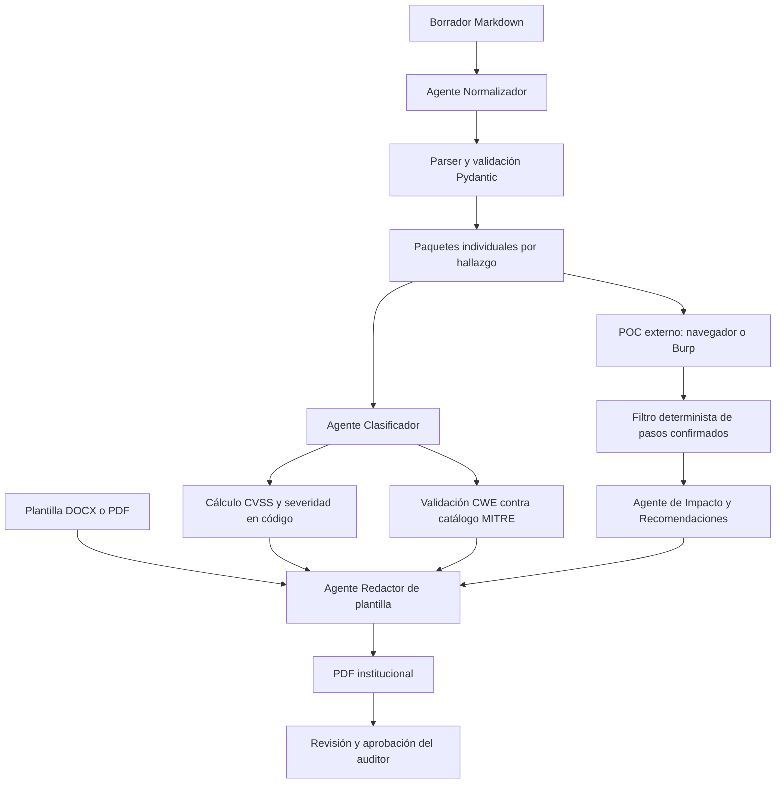

# A.G.N.I.S-Agent

MVP de una cadena de agentes en Python para convertir un borrador de auditoría web y una plantilla institucional en un informe PDF.

## Estado del MVP

El pipeline ya separa:

1. **Normalización:** transforma el Markdown en un modelo Pydantic.
2. **POC:** usa un adaptador explícito; el adaptador incluido no ejecuta peticiones y deja los pasos sin confirmar.
3. **Clasificación:** propone vector CVSS 4.0, OWASP y causa técnica.
4. **Impacto:** recibe únicamente pasos confirmados.
5. **Renderizado:** el último componente rellena la plantilla DOCX o PDF y produce un PDF.

Las decisiones deterministas —confirmación de pasos, puntuación CVSS, severidad y validación CWE— ya se ejecutan en código. La ejecución web real sigue siendo un adaptador externo.

## Instalación

```bash
python -m venv .venv
. .venv/bin/activate
pip install -e '.[openai,dev]'
cp .env.example .env
```

Edita `.env` y añade tu clave:

```dotenv
OPENAI_API_KEY=tu_clave_de_openai
```

La aplicación carga automáticamente `.env` mediante `python-dotenv`. El archivo
`.env` está excluido de Git y nunca debe subirse al repositorio.

## Uso

```bash
agnis borrador.md plantilla.docx --output informe.pdf \
  --cwe-catalog data/cwec_v5.0.xml
```

También se aceptan plantillas PDF:

```bash
agnis borrador.md plantilla.pdf --output informe.pdf
```

Las plantillas usan marcadores `{{nombre}}`. Están disponibles `{{application}}`,
`{{base_url}}`, `{{environment}}`, `{{test_date}}`, `{{finding_count}}` y, para cada
hallazgo, `{{finding_1.title}}`, `{{finding_1.asset}}`, `{{finding_1.owasp}}`,
`{{finding_1.cause}}`, `{{finding_1.cwe}}`, `{{finding_1.cvss_vector}}`,
`{{finding_1.cvss_score}}`, `{{finding_1.severity}}`, `{{finding_1.impact}}` y
`{{finding_1.recommendations}}`.

Para DOCX se necesita LibreOffice instalado para convertir el documento final a PDF.
En PDF, los marcadores deben existir como texto seleccionable; A.G.N.I.S. los reemplaza
conservando la posición de la plantilla.

## Catálogo CWE

El workflow `Sync CWE catalog` descarga semanalmente el catálogo oficial
`cwec_v5.0.xml` desde MITRE y abre un pull request cuando detecta cambios. También
puede ejecutarse manualmente desde la pestaña **Actions**. El catálogo queda en
`data/cwec_v5.0.xml` y no se modifica directamente la rama `main`.

El modelo se configura mediante `langchain-openai` y usa `gpt-4o-mini`. Los parámetros
se definen por agente en `agnis/agents.py`:

| Agente | Temperature | Top p | Max tokens | Justificación |
|---|---:|---:|---:|---|
| Normalizador | 0.0 | 0.1 | 2500 | Necesita reproducibilidad y conservar datos literalmente; se prioriza precisión. |
| Clasificador | 0.0 | 0.1 | 1200 | Propone valores técnicos acotados; se minimiza la variación del modelo. |
| Impacto | 0.2 | 0.3 | 1800 | Permite redactar frases claras manteniendo baja creatividad para no superar la evidencia. |

`temperature` controla la variabilidad, `top_p` limita el conjunto acumulado de
tokens candidatos y `max_tokens` limita la longitud de la respuesta. Los valores bajos
son intencionales: este flujo transforma datos de auditoría y necesita precisión,
trazabilidad y salidas repetibles, no generación creativa. El proveedor está aislado
en `agnis/llm.py` para poder sustituirlo sin modificar los agentes.

Si un adaptador POC externo produce observaciones, se pueden pasar como JSON:

```bash
agnis borrador.md plantilla.docx --output informe.pdf \
  --poc-results poc-results.json
```

El formato es un objeto por hallazgo:

```json
{
  "FF-001": [
    {"step_number": 1, "http_status": 200, "confirmed": true}
  ]
}
```

También existe un adaptador HTTP explícito para pruebas autorizadas. Solo ejecuta
las peticiones descritas en el archivo de especificación contra el mismo host de
`base_url`, y exige una confirmación opt-in:

```bash
agnis borrador.md plantilla.docx \
  --poc-http-spec poc-http.json \
  --allow-network \
  --artifacts-dir artifacts \
  --output informe.pdf
```

Ejemplo de `poc-http.json`:

```json
{
  "FF-001": [
    {
      "step_number": 1,
      "path": "/api/users",
      "method": "GET",
      "headers": {},
      "expected_status": 200
    }
  ]
}
```

El adaptador no sigue URLs fuera del host autorizado, limita el cuerpo leído, redacta
cabeceras sensibles y marca un paso como confirmado solo si coincide con
`expected_status`. Para navegador o Burp se mantiene el contrato de observaciones
JSON, de modo que pueden añadirse adaptadores sin cambiar el pipeline.

Con `--artifacts-dir` se conserva `resolved-report.json` para trazabilidad. Antes de
terminar, el pipeline valida que exista al menos un hallazgo, que cada clasificación
tenga puntuación CVSS, que no queden marcadores de plantilla y que el PDF se haya
generado correctamente.

## Diseño y gobernanza del workflow

### 1. Escenario seleccionado

A.G.N.I.S. se aplica al proceso de auditoría de seguridad web de una empresa,
universidad, mipyme o institución pública. El auditor parte de un borrador escrito
en Markdown y necesita convertirlo en un informe técnico formal, trazable y
compatible con la plantilla institucional.

El problema que resuelve el workflow es la formalización manual y repetitiva de
hallazgos de seguridad. El sistema estructura el borrador, separa cada hallazgo,
organiza la evidencia, propone clasificaciones técnicas y rellena una plantilla
DOCX o PDF para producir el informe final en PDF.

El sistema no sustituye al auditor: las observaciones del POC, las propuestas de
clasificación y el informe final deben poder ser revisados por una persona.

### 2. Diseño de prompts

Cada agente recibe únicamente la información necesaria para su tarea:

- **Normalizador:** recibe el Markdown original. Conserva literalmente las acciones,
  identifica hallazgos y marca como pendientes los datos que no aparecen.
- **Clasificador:** recibe un hallazgo estructurado y propone vector CVSS 4.0,
  categoría OWASP y causa técnica. No calcula puntuación ni severidad.
- **Impacto:** recibe solo los pasos confirmados. Describe el impacto demostrado y
  propone recomendaciones sin inventar consecuencias.
- **Redactor de plantilla:** recibe los datos ya resueltos por código y solo sustituye
  marcadores de la plantilla.

Los prompts incorporan medidas de precisión y seguridad:

1. **Alcance limitado:** cada agente tiene una responsabilidad única.
2. **Prohibición de invención:** los datos ausentes se marcan como pendientes.
3. **Separación entre observación y decisión:** el modelo no confirma exploits ni
   calcula CVSS; esas decisiones se ejecutan en código.
4. **Salida estructurada:** las respuestas se validan con modelos Pydantic.
5. **Trazabilidad:** los impactos deben referenciar pasos confirmados.
6. **Minimización de datos:** no se envía el documento completo a todos los agentes.
7. **Supervisión humana:** el auditor conserva la decisión final antes de publicar.

### 3. Configuración del modelo

El proveedor actual es `gpt-4o-mini` mediante LangChain. Los parámetros se ajustan
según el objetivo de cada agente:

| Agente | Temperature | Top p | Max tokens | Justificación |
|---|---:|---:|---:|---|
| Normalizador | 0.0 | 0.1 | 2500 | Tarea de extracción; se priorizan fidelidad, precisión y reproducibilidad. |
| Clasificador | 0.0 | 0.1 | 1200 | Tarea técnica acotada; se reduce la variación y la creatividad. |
| Impacto | 0.2 | 0.3 | 1800 | Tarea de redacción controlada; permite claridad sin alejarse de la evidencia. |

`temperature` regula la variabilidad de la generación, `top_p` limita la distribución
acumulada de tokens candidatos y `max_tokens` limita la longitud máxima de respuesta.
Los valores bajos son apropiados porque el workflow transforma información de
auditoría: la precisión y la consistencia son más importantes que la creatividad.

### 4. Arquitectura del workflow



El flujo de entrada es el borrador y la plantilla. El procesamiento combina agentes
LangChain con validaciones deterministas en Python. La salida es un PDF basado en la
plantilla institucional. La supervisión ocurre durante la confirmación de resultados
y antes de la publicación.

El POC incluido en este MVP funciona como límite de integración. El adaptador HTTP
ejecuta únicamente peticiones declaradas y autorizadas; navegador o Burp pueden
producir el mismo JSON de observaciones confirmadas.

### 5. Decisión final y justificación técnica

Se eligió Python con LangChain porque permite construir agentes con prompts
especializados, salida estructurada y sustitución del proveedor LLM. Pydantic valida
los contratos entre etapas; Python ejecuta las reglas que no deben quedar a criterio
del modelo; PyMuPDF y `python-docx` permiten trabajar con plantillas PDF y DOCX.

La arquitectura desacoplada mejora la eficiencia porque automatiza la transcripción,
clasificación preliminar y maquetación repetitiva. Mejora la seguridad porque limita
el contexto de cada agente, evita que el modelo calcule decisiones críticas, valida el
CWE contra el catálogo oficial y exige evidencia confirmada para redactar impacto.
Los fallos de validación deben detener la generación en lugar de producir un informe
con apariencia de completitud.

### 6. Ética, privacidad y normativa

#### Riesgos identificados

- **Privacidad:** los borradores pueden contener nombres, correos, direcciones IP,
  tokens, cookies o datos de usuarios.
- **Sesgos y errores:** el modelo puede proponer una clasificación incorrecta o
  interpretar de forma desigual hallazgos similares.
- **Alucinaciones:** el modelo puede agregar impactos, recomendaciones o datos no
  demostrados.
- **Opacidad:** una propuesta automática puede parecer una decisión definitiva.
- **Riesgo operativo:** un POC mal configurado podría afectar sistemas reales.
- **Dependencia del proveedor:** el envío de información a una API externa puede
  generar riesgos contractuales, de residencia y retención de datos.

#### Medidas de gobernanza

1. Anonimizar o redactar secretos, datos personales y credenciales antes del envío.
2. Mantener `.env` fuera del repositorio y gestionar las claves como secretos.
3. Conservar el borrador original, entradas, salidas, versiones y decisiones para
   asegurar trazabilidad.
4. Aplicar revisión humana obligatoria antes de ejecutar acciones y publicar el PDF.
5. Validar esquemas, CWE, CVSS, marcadores y campos obligatorios en código.
6. Ejecutar pruebas únicamente dentro del alcance autorizado y con cuentas de prueba.
7. Registrar errores y bloquear salidas incompletas en lugar de ocultarlos.
8. Revisar periódicamente prompts, proveedores, permisos, dependencias y catálogo CWE.
9. Definir retención, acceso y eliminación de evidencias según la política institucional.

#### Marcos legales y regulatorios

El proyecto debe adaptarse a la jurisdicción de la institución y contar con revisión
legal. Como referencias de gobernanza se consideran:

- **GDPR/RGPD:** minimización, limitación de finalidad, base jurídica, seguridad,
  control de acceso, retención y derechos de los titulares cuando se procesen datos
  personales.
- **EU AI Act:** gestión de riesgos, transparencia, supervisión humana, documentación,
  registro de operaciones y controles proporcionales al uso previsto del sistema.
- **Decreto Ley 78/2023:** debe analizarse según su ámbito territorial y sectorial,
  identificando las obligaciones locales aplicables a ciberseguridad, datos y uso de
  sistemas automatizados.

Estas referencias no sustituyen asesoría jurídica. El responsable del tratamiento y
la institución deben determinar qué normativa aplica al caso concreto.

### 7. Estado de cumplimiento

| Requisito | Estado |
|---|---|
| Escenario y problema definidos | Implementado |
| Prompts con restricciones de precisión y seguridad | Implementado |
| Temperature, Top p y Max tokens definidos y justificados | Implementado |
| Workflow con LangChain y agentes especializados | Implementado |
| Diagrama entrada → procesamiento → salida → supervisión | Implementado |
| Decisiones críticas ejecutadas en código | Implementado parcialmente; falta completar el adaptador POC real |
| Salida basada en plantilla DOCX/PDF y PDF final | Implementado |
| Gobernanza ética y referencias normativas | Definido |
| POC real de navegador o Burp | Pendiente |
